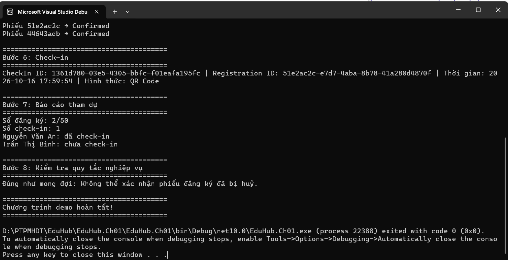

# EduHub — Ch01: Domain Modeling

Đáp án mẫu của bài tập Ch01 (HĐ1.3). Domain gồm 5 class: `Member`, `Club`, `Event`, `Registration`, `CheckIn`.

## Thiết kế

- Mỗi class dùng `private set`, constructor private và factory `Create(...)` có kiểm tra dữ liệu đầu vào.
- Danh sách thành viên của `Club` chỉ đọc (`IReadOnlyList`); muốn thêm phải gọi `AddMember`.
- Luật nghiệp vụ nằm trong class: `Registration.Confirm()` chỉ hợp lệ khi Pending, Cancelled là trạng thái cuối, `CheckIn.Create()` chỉ cho phiếu Confirmed.
- Trạng thái và hình thức điểm danh dùng hằng số (`RegistrationStatus`, `CheckInMethod`), không dùng magic string.
- Tài liệu phân tích: `docs/user-stories.md`, `docs/class-diagram.md`.

## Chạy

```bash

dotnet run
```

Chương trình chạy luồng: tạo CLB, thêm 3 thành viên, tạo sự kiện, đăng ký, xác nhận, check-in, báo cáo tham dự,
rồi minh hoạ một luật nghiệp vụ (phiếu đã huỷ không thể xác nhận lại).

## Ảnh chụp kết quả chạy

